# MyIECChecks

[](https://opensource.org/licenses/MIT)
[](https://www.br-automation.com)

This B&R Automation Studio library implements checking functions for division, modulo operators, range violations, array accessing, as well as read/write operations performed on memory locations.

If the option -D _IGNORE_CHECKLIB is enabled in the additional build options, then the functions in this library are not used.

Find more details in [Online Help](https://help.br-automation.com/#/en/6/libraries%2Flibraries%2Fiecchecklibrary%2Fprogrammingmodel_libraries_iecchecklibrary.html)

IEC check functions intercept invalid accesses within IEC programs and execute the underlying exception-handling code. This allows the application to continue running uninterrupted. However, the drawback of this approach is that Automation Runtime does not generate backtrace data for diagnostics.

MyIECChecks enhances this behavior in two key ways: first, it creates an entry in the system log indicating the fault; second, it subsequently raises an exception, which prompts Automation Runtime to generate backtrace data for pinpointing the exact location in the code.

A typical entry looks as follows:
 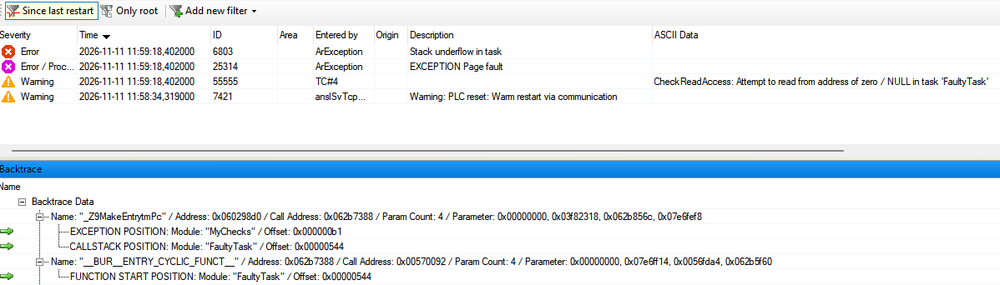


## Functions / function blocks for logging

### CheckDivDint

Check divisor for DINT division


### CheckDivUdint

Check divisor for UDINT division


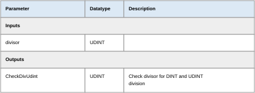

### CheckDivInt

Check divisor for INT division


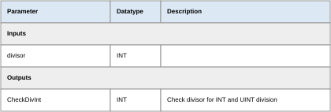

### CheckDivUint

Check divisor for UINT division


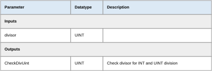

### CheckDivSint

Check divisor for SINT division


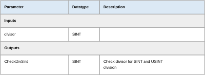

### CheckDivUsint

Check divisor for USINT division


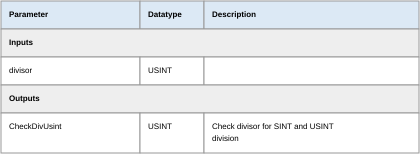

### CheckDivReal

Check divisor for REAL division


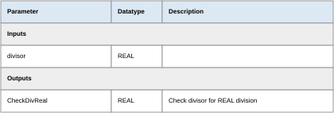

### CheckDivLReal

Check divisor for LREAL division (not available for SG3 and SGC)


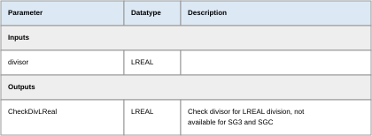

### CheckBounds

Check range for array access

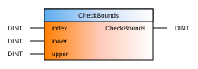
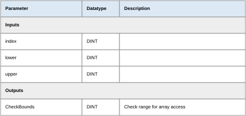

### CheckRange

Check range for enumeration

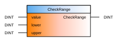


### CheckSignedSubrange

Check range for subrange of signed data types

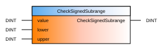
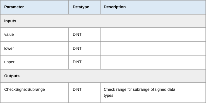

### CheckUnsignedSubrange

Check range for subrange of unsigned data types

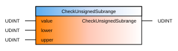
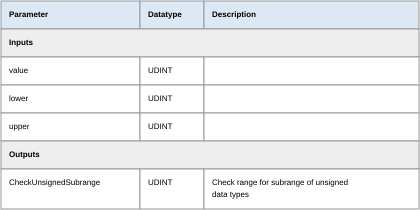

### CheckReadAccess

Check address when reading dynamic variables


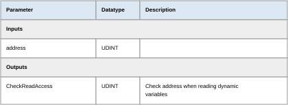

### CheckWriteAccess

Check address when writing dynamic variables


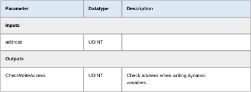

### MCH_Trigger9206

Force a watchdog error


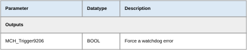

## Usage

Except MCH_Trigger9206 all functions are called by Automation Runtime NOT by user !

To validate the functions prior to commissioning on the physical machine, the following test code can be executed:

### Types.typ

```st
TYPE
	New_Enumeration : 
		(
		one := 1,
		two := 2,
		three := 3
		);
END_TYPE

```

### Variables.var

```st
VAR
	trigger_div_lreal : BOOL;
	trigger_div_real : BOOL;
	trigger_div_sint : BOOL;
	trigger_div_usint : BOOL;
	trigger_div_int : BOOL;
	trigger_div_uint : BOOL;
	trigger_div_udint : BOOL;
	trigger_div_dint : BOOL;
	trigger_check_bounds1 : BOOL;
	trigger_check_bounds2 : BOOL;
	limited_usint : USINT(0..10);
	limited_sint : SINT(-10..+10);
	trigger_check_range : BOOL;
	trigger_check_signed_subrange : BOOL;
	trigger_check_unsigned_subrange : BOOL;
	trigger_bad_read_access : BOOL;
	trigger_watchdog : BOOL;
	dynamicVariable : REFERENCE TO USINT;
	trigger_bad_write_access : BOOL;
	integerNumber : DINT;
	enum : New_Enumeration;
	array : ARRAY[3..9] OF USINT;
	floatingPointNumber : LREAL;
	result : LREAL;
END_VAR
``` 

### Main.st

```st
PROGRAM _INIT

END_PROGRAM

PROGRAM _CYCLIC

	IF trigger_div_dint THEN
		trigger_div_dint := FALSE;
		result := integerNumber / DINT#0;
	ELSIF trigger_div_udint THEN
		trigger_div_udint := FALSE;
		result := DINT_TO_UDINT(integerNumber) / UDINT#0;
	ELSIF trigger_div_int THEN
		trigger_div_int := FALSE;
		result := integerNumber / DINT_TO_INT(0);
	ELSIF trigger_div_uint THEN
		trigger_div_uint := FALSE;
		result := DINT_TO_UDINT(integerNumber) / UINT#0;
	ELSIF trigger_div_sint THEN
		trigger_div_sint := FALSE;
		result := integerNumber / SINT#0;
	ELSIF trigger_div_usint THEN
		trigger_div_usint := FALSE;
		result := DINT_TO_UDINT(integerNumber) / UINT#0;
	ELSIF trigger_div_real THEN
		trigger_div_real := FALSE;
		result := floatingPointNumber / REAL#0.0;
	ELSIF trigger_div_lreal THEN
		trigger_div_lreal := FALSE;
		result := floatingPointNumber / LREAL#0.0;
	ELSIF trigger_check_bounds1 THEN
		trigger_check_bounds1 := FALSE;
		integerNumber := 10; 
		result := array[integerNumber]; (* limited to 3..9 *)
	ELSIF trigger_check_bounds2 THEN
		trigger_check_bounds2 := FALSE;
		integerNumber := 2;
		result := array[integerNumber]; (* limited to 3..9 *)
	ELSIF trigger_check_range THEN
		trigger_check_range := FALSE;
		integerNumber := 10;
		enum := integerNumber;
	ELSIF trigger_check_signed_subrange THEN
		trigger_check_signed_subrange := FALSE;
		integerNumber := 11;
		limited_sint := DINT_TO_SINT(integerNumber);  (* limited to -10..+10 *)
	ELSIF trigger_check_unsigned_subrange THEN
		trigger_check_unsigned_subrange := FALSE;
		integerNumber := 11;
		limited_usint := DINT_TO_USINT(integerNumber); (* limited to 0..+10 *)
	ELSIF trigger_bad_read_access THEN
		trigger_bad_read_access := FALSE;
		dynamicVariable ACCESS 0;
		result := dynamicVariable;		
	ELSIF trigger_bad_write_access THEN
		trigger_bad_write_access := FALSE;
		dynamicVariable ACCESS 0;
		dynamicVariable := 1;
	ELSIF trigger_watchdog THEN
		trigger_watchdog := FALSE;	
		MCH_Trigger9206();	
	END_IF
	 
END_PROGRAM
```